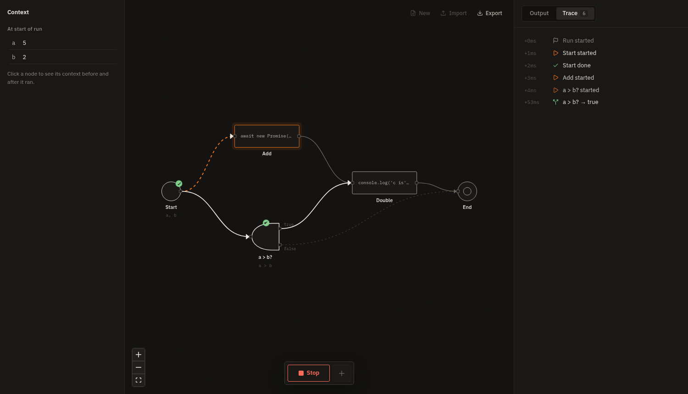
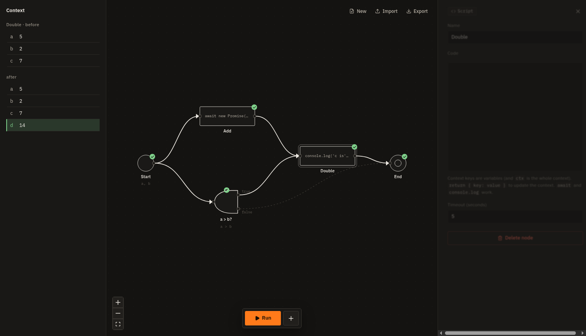

# Workflow Runner

A browser-only tool for building and running workflows. You draw a graph of **Start → Script / Decision → End** nodes on a canvas, press **Run**, and watch the branches execute in parallel. Each node's context is recorded, so you can inspect it before and after the node ran.



## Quick start

Requires **Node ≥ 22.18** (the tests use Node's built-in TypeScript support).

```sh
npm install
npm run dev
```

Open the printed URL, click **Import**, choose [`examples/sketch.json`](examples/sketch.json), and press **Run**.

| Script               | What it does                                                                  |
| -------------------- | ----------------------------------------------------------------------------- |
| `npm run dev`        | Dev server with hot reload                                                    |
| `npm run build`      | Typecheck and production build into `dist/`                                   |
| `npm run preview`    | Serve the production build                                                   |
| `npm run check`      | Typecheck, lint (warnings fail), and unit tests                               |
| `npm test`           | Unit tests: execution engine, validation, file import                         |
| `npm run test:e2e`   | Builds, then drives the production build in headless Chrome (see [Testing](#testing)) |

## Using it

- **+** adds a Script, Decision or End node. Drag from a node's handle to another node to connect them. Clicking a node opens its editor. **Delete** or **Backspace** removes the selected node or edge. The Start node can't be deleted.
- **Start** declares the workflow's inputs (for example `a, b`). **Run** asks for their values. A value that is valid JSON is read as JSON (`2` is a number, `[1,2]` an array), and anything else as text.
- **Script** nodes run JavaScript. Context keys are local variables, and `ctx` is the whole context (read-only). Return an object to merge it into the context:
  ```js
  console.log('adding', a, b)
  return { c: a + b }
  ```
  Scripts can use `await`. Each script has a timeout, 5 s by default.
- **Decision** nodes hold one expression, such as `a > b`. A truthy result takes the `true` exit, and anything else takes `false`.
- The workflow **autosaves** to localStorage. **Export** and **Import** use JSON files.



## How a run executes

1. **Validation.** Run refuses to start if any node is unreachable from Start, can't reach an End, has no exit, or is a Decision missing its true or false exit. It also refuses if any code is empty or an input name isn't a valid variable name. The problem nodes are highlighted and listed. Loops can't be drawn: an edge that would close one is refused.
2. **Parallel branches.** Every exit of a node starts its own branch. Each branch gets its own copy of the context.
3. **Skips.** A Decision's untaken exit sends a *skip* signal down that path, so the nodes on it are skipped.
4. **Joins.** A node with several inputs waits until each input has either arrived or been skipped. It runs **once** if at least one input arrived, and is skipped if all were skipped. This is what lets the sketch's `Double` node work whichever way the decision goes.
5. **Merging.** Context copies merge where branches join. If two branches wrote the same key with different values, the branch that **finished last** wins and the trace shows a warning. A key that only one branch changed merges without a warning, because each value keeps a record of the writes that replaced it.
6. **Finishing.** The run ends when every branch has reached an End or been skipped. The result is the merged context from the End nodes that were reached.
7. **Errors.** If a script throws or times out, the whole run fails. The other branches are cancelled, and the error shows the line it came from. **Stop** cancels everything that is running.

## Code map

```
src/
  engine/
    runner.ts          Execution engine: signals, joins, context merge. Script execution is injected,
                       so the engine is UI-free and unit-tested in Node.
    validate.ts        Pre-run checks and cycle detection
    worker.ts          Web Worker that runs one script/expression
    workerExecutor.ts  Starts one worker per node, with timeout and cancel
  App.tsx              Canvas, toolbar, run lifecycle, autosave, import/export
  nodes.tsx            Node shapes (Start, Script, Decision, End) and status badges
  panels/              Context panel, Output/Trace panel, node editor, inputs dialog
  storage.ts           Serialize, parse (validates and repairs imported files), localStorage, download
  types.ts             Shared types
  index.css, App.css   Design tokens (color, type, motion) and styles
tests/
  engine.test.ts       Engine semantics: joins, skips, conflicts, failures, stop
  storage.test.ts      Import parsing and repair
  e2e/browser.test.mjs End-to-end tests against the production build
examples/sketch.json   The workflow from the original whiteboard sketch
```

## Design notes

- **Rendering.** The canvas is [React Flow](https://reactflow.dev). Nodes are HTML, and edges are SVG; nothing draws to `<canvas>`. That keeps text crisp, lets everything be styled and animated with CSS, and gives normal DOM events and accessibility.
- **Look.** Warm graphite with hairline borders, 3 px corners, and IBM Plex Sans and Mono (bundled, not loaded from a CDN). There is a single signal-orange accent, kept for Run and for what's executing right now. Finished paths light up white, and skipped ones fade to dashes.
- **Motion.** One set of timings and easings, after [transitions.dev](https://transitions.dev): 150, 250 and 350 ms on `cubic-bezier(0.22, 1, 0.36, 1)`. Menus and the dialog close faster than they open. Everything is plain CSS, with no animation library. Motion is turned off when the OS reduce-motion setting is on, and state is always shown by color, icons and text as well.
- **Bundle.** CodeMirror is about half the JavaScript, so it is lazy-loaded and prefetched shortly after startup. The initial bundle is about 166 kB gzipped.

## Testing

- `npm test` runs the unit tests in Node, with an in-process executor standing in for the Web Worker. It needs nothing installed beyond the npm dependencies.
- `npm run test:e2e` builds the app, serves it with `vite preview`, and drives it in headless Chrome over the DevTools protocol. No Puppeteer or Playwright is needed. It covers the real worker sandbox (timeouts, error line numbers, non-serializable returns), the UI flows and Stop.
  - The test finds `chromium` or `google-chrome` on `PATH`; set `CHROME_PATH` otherwise.
  - Set `E2E_SCREENSHOTS=<dir>` to save a screenshot after each test.

## Known limitations

These are deliberate for a prototype:

- **Not a security sandbox.** Scripts run in a Web Worker, which isolates them from the page and the UI thread. A worker can still use `fetch` and same-origin storage, so only run code you trust.
- **No loops.** Combining loops with parallel branches and joins needs its own design.
- **Single user and local only.** There is no backend, and autosave is per browser. Export/Import is the way to share a workflow.
- **Desktop layout.** The fixed three-column layout isn't built for small screens.
- **No undo, and native dialogs.** New and Import errors use `confirm` and `alert`.
- **One worker per script run.** Starting a worker costs a few milliseconds per node, which is fine at this scale. A worker pool would be the next step.
